<!--
  GitHub profile README for Abtaal2003.
  Lives in the repo named "Abtaal2003" as README.md, with banner.svg and footer.svg in assets/.

  PALETTE (matches Ultron Prime)
    crimson  : b11226   badges
    red      : d4202f   accents, rules, icons
    bright   : ff4d4d   titles, highlights
    deep     : 8f0f1f   gradient floor
    ink      : 0d1117   badge labels, card backgrounds
    text     : c9d1d9   body text on cards
    muted    : 9aa4b2   secondary text
-->

### I build AI agents that are measured and hardened, not just demoed.

[About](#about) ·
[Now](#now) ·
[Selected work](#selected-work) ·
[Experience](#experience) ·
[Toolbox](#toolbox) ·
[Stats](#stats)

---

## About

I am an AI Engineer based in Helsinki, doing an MSc in Data Science at the **University of Helsinki** on a full tuition-fee waiver.

Most recently I was at **IBM**, building computer vision and multimodal RAG pipelines for infrastructure maintenance. Before that I spent a year at **Data Science Dojo**, where I worked with client teams to ship 15+ LLM agents into two enterprise products and wired a multi-agent platform into six MCP servers.

What I care about is agents that hold up once they leave the demo: evaluated on real queries, guarded in code rather than in the prompt, and honest about what they do not know.

> Summa Cum Laude, BSc Computer Science, FAST-NUCES. Ranked 3rd of 600+ graduates, four Gold Medals.

## Now

- Studying for the MSc in Data Science at the University of Helsinki
- Building **Ultron Prime**, a security-first AI agent that blocks prompt injection in code instead of in the system prompt
- Writing a public library of technical reference guides in [`deep-dives`](https://github.com/Abtaal2003/deep-dives)
- Volunteering at **Slush 2026** and learning Swedish
- Looking for AI engineering work in Europe, available immediately

## Selected work

| Project | What it is | Built with |
| :--- | :--- | :--- |
| **Ultron Prime**  repo opening soon | Personal AI agent with a tool gate, egress holds and consent-gated memory. 0% attack success on 4 of 5 AgentDojo suites. | LangGraph · FastAPI · React |
| [**parts-identifier**](https://github.com/Abtaal2003/parts-identifier) | Multimodal RAG that matches field photos to a parts catalogue, with a 50-query eval set and CI tests | FastAPI · sentence-transformers · Cerebras |
| [**ketogenesis**](https://github.com/Abtaal2003/ketogenesis) | Live storefront for a food business with an LLM assistant grounded in its 77-item catalogue. [ketogenesis.shop](https://ketogenesis.shop) | Cloudflare Workers · Groq · Gemini |
| [**deep-dives**](https://github.com/Abtaal2003/deep-dives) | Concept-by-concept technical reference guides, written to be read by anyone | Markdown |
| [**projects**](https://github.com/Abtaal2003/projects) | Hands-on solo builds for learning, upskilling and practice | Python |
| [**IBM-Data-Science-Capstone**](https://github.com/Abtaal2003/IBM-Data-Science-Capstone-Project) | Notebook work from the IBM Data Science Professional Certificate | Jupyter · Pandas |

## Experience

| Role | Where | When | One result |
| :--- | :--- | :--- | :--- |
| **AI Engineer** | IBM | Nov 2025 to Aug 2026 | Multimodal RAG parts matcher at **98% top-1** accuracy and **16.6 ms** median retrieval |
| **Associate Data Scientist II**  promoted twice from intern | Data Science Dojo | Feb 2025 to Nov 2025 | Tool-routing accuracy raised from **65% to 85%** across 1,000+ agent conversations |
| **AI R&D Intern** | Plutus21 Capital | Oct 2024 to Feb 2025 | AutoGen multi-agent system mapping company names to tickers |
| **Data Science Intern** | 10Pearls | Jun 2024 to Aug 2024 | Churn prediction model served through a Flask API |

## Toolbox

**AI and ML**

**Engineering**

**Data**

## Stats

## Certifications and recognition

## Languages

